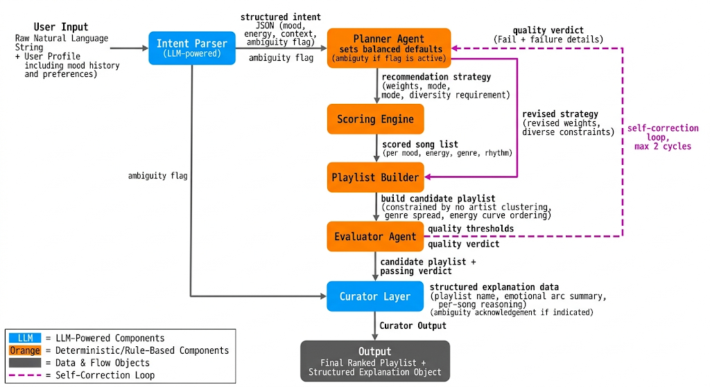

# Symphoria AI 🎧

**An interpretable music recommendation prototype that turns a mood or listening request into a curated playlist.**

Symphoria explores a simple question: *How can a recommender make sensible choices without hiding all of its logic inside a black-box model?* It uses a modular, primarily rule-based Python pipeline to interpret a prompt, choose a matching strategy, score songs, build a playlist, and explain the result.

**[Watch the CLI walkthrough](https://www.loom.com/share/72f46fe31ff24c788ceee413df45d829)** · **Run locally:** `python -m src.main`

> **Project scope:** This is a command-line proof of concept built around a curated 90-song dataset, its focus is explainable system design and experimentation.


## How it works

1. **Interpret:** `intent_parser.py` translates requests such as “chill lo-fi music for studying” into structured signals including mood, genre, energy, valence, and acoustic preferences.
2. **Plan:** `planner_agent.py` selects a focused, balanced, or exploratory strategy based on how clearly it can interpret the request.
3. **Recommend:** `recommender.py` scores the catalog using weighted feature comparisons; `playlist_builder.py` assembles the selected tracks with attention to artist diversity and energy flow.
4. **Evaluate and explain:** `evaluator_agent.py` checks playlist quality and can trigger refinement. `curator_agent.py` adds a playlist title, summary, and per-track rationale.

### Architecture



This architecture follows a modular hybrid pipeline that separates understanding, decision-making, and execution. An intent layer interprets raw user input and converts it into structured preferences, which are then passed to a Planner Agent that defines the recommendation strategy, including weighting signals, diversity constraints, and energy behavior. This keeps the system flexible at the top while maintaining controlled, predictable behavior downstream.

The lower layers are deterministic. A scoring engine ranks songs using fixed rules over audio and preference features, and a playlist builder assembles the final list while enforcing constraints like artist diversity and optional energy flow ordering. An evaluator layer checks output quality and can trigger refinement if needed, while the curator layer generates human-readable explanations, including playlist naming, emotional arc, and per-song reasoning to make the results interpretable.

## Try it locally

Requires Python and the dependencies listed in `requirements.txt`.

```bash
# Clone the repository, then move into its directory
# git clone <repository-url>
# cd <repository-directory>

python -m venv .venv
```

Activate the environment:

```bash
# macOS / Linux
source .venv/bin/activate

# Windows PowerShell
# .venv\Scripts\Activate.ps1

# Windows Command Prompt
# .venv\Scripts\activate.bat
```

Then install dependencies and run:

```bash
pip install -r requirements.txt
python -m src.main
```

To run the included tests:

```bash
pytest
```

*The latest test suite has not been independently verified for this README revision; run it locally before reporting a pass count.*

## Example interaction

For the input:

```text
something chill and relaxed for studying
```

The walkthrough shows the system interpreting the request as a low-energy, focused listening context, choosing `focused` mode, and generating a playlist with short explanations for each track. One example output includes:

```text
Intent: ['chill', 'relaxed', 'focused']
Plan: focused (confidence: 0.95)
Evaluation: 0.89 | Pass: True

01. Spacewalk Thoughts — Orbit Bloom
    Why: ambient supports mood chill with energy 0.28
02. Midnight Coding — LoRoom
    Why: lofi supports mood chill with energy 0.42
```

These figures are from **one documented example run**, not a benchmark-wide accuracy claim. The complete terminal flow is in the [video walkthrough](https://www.loom.com/share/72f46fe31ff24c788ceee413df45d829).

## Design choices and experiments

**Why use rules instead of a trained model?** With a small catalog, explicit weights make it easier to understand why a song was selected and to test changes deliberately. The trade-off is limited flexibility when requests contain unfamiliar wording or complex, contradictory preferences.

**What changed during experimentation?** Reducing the genre weight from `2.0` to `0.5` made genre less dominant in the observed recommendations, allowing mood and energy to influence more of the playlist. Adding tempo and valence helped express rhythm and emotional tone, but strong feature weights could also produce clusters of similar-energy songs.

**What remains difficult?** Vague prompts and mixed moods can confuse keyword-based intent parsing. The system can also favor familiar genres or mood patterns because its catalog and rules are limited. A more robust evaluation would compare this pipeline with simpler baselines on a fixed set of labeled prompts, measuring relevance, diversity, and constraint violations.

## Project structure

| File | Responsibility |
| --- | --- |
| `src/intent_parser.py` | Convert free-text requests into preferences |
| `src/planner_agent.py` | Choose a recommendation strategy |
| `src/recommender.py` | Score candidate songs |
| `src/playlist_builder.py` | Assemble and order the playlist |
| `src/evaluator_agent.py` | Check quality and guide refinement |
| `src/curator_agent.py` | Produce a readable playlist summary |
| `src/main.py` | Run the interactive CLI |
| `data/songs.csv` | Curated song catalog |

## What I took away

The most interesting part was seeing how small changes in intent parsing or feature weights could change the result downstream. Building the pipeline in separate pieces made those decisions easier to inspect, challenge, and improve.


  
Overall, AI worked best as a design assistant and debugging guide, but I had to carefully filter suggestions to match the project goals and keep the system understandable and testable.
